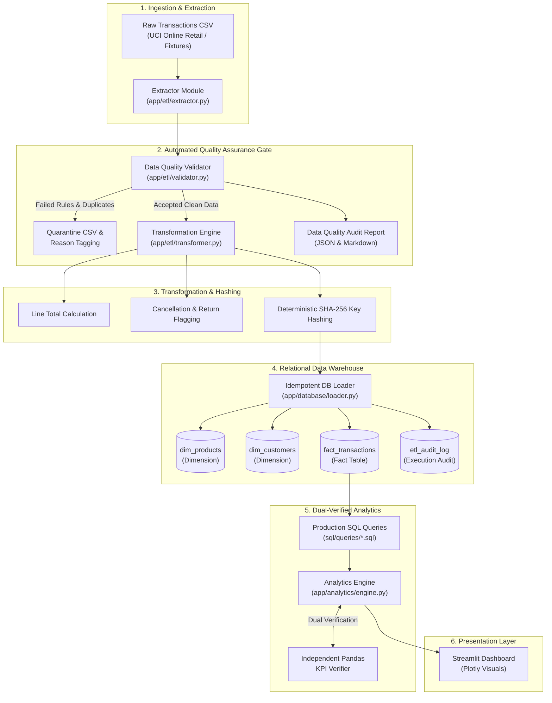
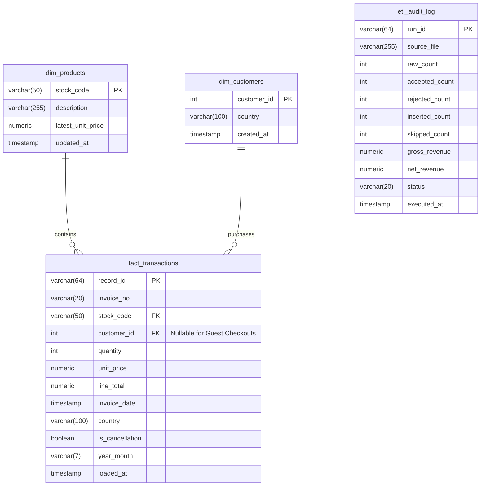

# System Architecture & Technical Design

## 1. High-Level Architecture Overview

The **E-commerce Sales Analytics & Automated QA Platform** is an enterprise data engineering and quality assurance solution that extracts, validates, transforms, loads, and visualizes retail transactions with dual-verified financial reconciliation.

---

## 2. Relational Entity-Relationship Diagram (ERD)

---

## 3. Idempotent Ingestion Design
To guarantee that pipelines can be triggered on an automated cron schedule or CI/CD re-run without inflating metrics:
1. Every record receives a surrogate business key generated via SHA-256 over:
   $$\text{Hash} = \text{SHA256}(\text{InvoiceNo} \parallel \text{StockCode} \parallel \text{InvoiceDate} \parallel \text{Quantity} \parallel \text{UnitPrice} \parallel \text{CustomerID})$$
2. Prior to database insertion, existing `record_id`s in the warehouse are queried in indexed batches.
3. Only genuinely unrecorded entries are inserted. Existing entries are incremented in the `skipped_count` audit metric.
4. Total fact table rows remain strictly constant on consecutive runs.
