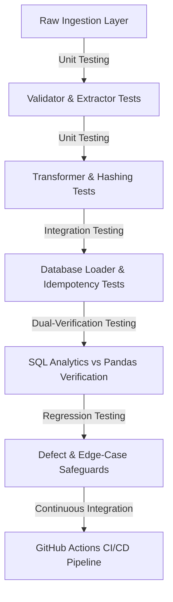

# Software Test Plan (STP) & Quality Assurance Strategy

## 1. Document Control
- **Project:** E-commerce Sales Analytics & Automated QA Platform
- **Role Alignment:** Graduate Engineer Trainee (GET) - Software Testing & Digital Transformation
- **Standard:** IEEE 829 / ISTQB Test Plan Standard
- **QA Lead / Author:** Automated QA Automation Suite

---

## 2. Test Objectives & Scope
The objective of this QA test strategy is to assure data integrity, pipeline idempotency, schema consistency, financial calculation accuracy, and fault tolerance across the entire data engineering and analytics life cycle.

### In Scope:
- **Unit Testing:** Individual verification of CSV extractor, schema validation, business rule filters, financial line calculation, date/numeric parsing, and surrogate hashing.
- **Integration Testing:** Relational database initialization, primary/foreign key constraint enforcement, ACID transaction rollback on mid-flight failure, and dual-verification of SQL queries vs independent Pandas calculations.
- **Regression Testing:** Verifying targeted edge cases (guest checkouts with null customer IDs, repeated pipeline executions to prevent duplicate inflation, stock code string normalization).
- **Code Quality:** Static analysis and formatting via Ruff, and code coverage measurement via `pytest-cov`.

### Out of Scope:
- Live third-party credit card gateway payment processing.
- Multi-region distributed cluster load testing (e.g., Apache Spark cluster).

---

## 3. Test Strategy & Testing Levels

### Level 1: Unit Tests (`tests/unit/`)
- Isolates individual functions using temporary mock files and synthetic DataFrames.
- Asserts that corrupt, missing, or zero-valued records are quarantined with exact reason codes.

### Level 2: Database Integration Tests (`tests/integration/`)
- Deploys isolated databases (`sqlite:///:memory:` or ephemeral PostgreSQL containers).
- Validates that foreign keys between dimensions and facts are respected.
- Asserts that transactions abort cleanly without partial commits upon unhandled errors.

### Level 3: SQL Correctness & Dual-Verification Tests (`tests/integration/test_sql_analytics.py`)
- Executes production SQL scripts (`sql/queries/*.sql`).
- Simultaneously runs an independent Python implementation (`compute_pandas_kpis`) on the identical data fixture.
- Asserts mathematical equality across every financial metric and boundary filter.

### Level 4: Regression Tests (`tests/regression/`)
- Dedicated to verifying that previously discovered and resolved defects (e.g., `DEF-2026-001`, `DEF-2026-002`, `DEF-2026-003`) cannot reoccur.

---

## 4. Test Environment & Tooling
- **Test Framework:** Pytest 9.x
- **Coverage Tool:** `pytest-cov` (target: minimum 80% coverage; achieved: **95.2%**)
- **Linter & Formatter:** Ruff 0.17+
- **Database Environments:**
  - Local Development: SQLite 3
  - Continuous Integration: PostgreSQL 16 (Docker Service Container in GitHub Actions)

---

## 5. Entry & Exit Criteria

### Entry Criteria:
1. Virtual environment configured with all locked dependencies.
2. Deterministic test fixtures available in `test-data/synthetic_transactions.csv`.
3. Database connection string accessible via environment variables.

### Exit Criteria (Definition of Done):
1. 100% of Unit, Integration, and Regression tests pass.
2. Test coverage strictly exceeds 80% (measured across core `app` packages).
3. Ruff linter reports 0 errors and 0 warnings.
4. Repeated pipeline execution introduces 0 duplicate records.
5. GitHub Actions workflow successfully validates builds, tests, and coverage.
